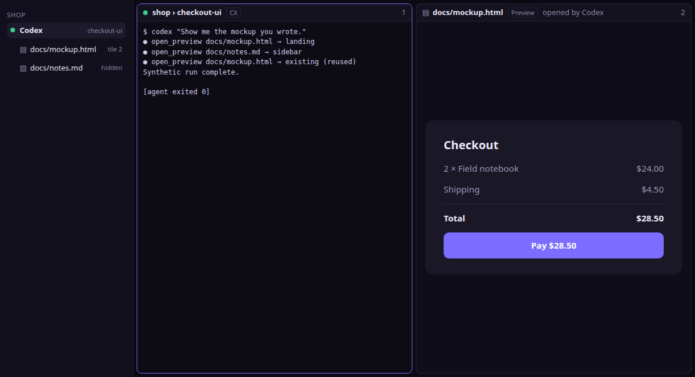

# Agent-opened previews (research spike, #222)

Findings from the spike on letting an agent open a preview of a file it wrote ("here's the mockup") through Foom's control plane. The prototype lives in [`spikes/agent-previews/`](../spikes/agent-previews/README.md). It is throwaway code; nothing under `src/` changed. Read it with [the preview spike](previews.md) (#221), which settled how a preview is isolated, served and reloaded. This document covers only how an agent asks for one. It is research, not a decision: the follow-up tickets below decide each part, and each updates `architecture.md`, `orchestration.md` and `product.md` when it lands.

**Recommendation:** add three tools for every Foom-launched agent: `open_preview`, `list_previews` and `close_preview`. They act only on files in the caller's own worktree and on previews the caller opened. They change only Foom's view, so they need no trusted dialog, but they ship with the visibility and takeover rules below. They must also never take focus. That rule needs a specific technique: the spike measured an unmitigated preview capturing **190 of 300 keystrokes** typed into the terminal while it loaded.

## How this was measured

Linux, Node 24.17.0, Electron 44 from the repository, Claude Code **2.1.296**, Codex **0.162.1**, Antigravity **1.3.3**. No provider credentials and no real model: a scripted loopback model (`model.mjs`) speaks the Anthropic Messages and OpenAI Responses streaming formats and makes the real CLIs call the tools in a fixed order. The order is: open `docs/mockup.html`, try `../outside/secret.md`, then list. Each CLI runs with a temporary `HOME`, `CLAUDE_CONFIG_DIR` or `CODEX_HOME`. `server.mjs` bundles Foom's real `src/main/control` modules unchanged and patches the preview tools in at run time. So authentication, the MCP session rules, the per-launch attachment (`prepareMcpLaunch`) and the result envelope are production code.

| Run | What it shows | Result file |
|---|---|---|
| `broker.test.cjs` (9 tests) | Authority, ownership, placement, limits, dismissal, revocation, audit fields | — |
| `clients.mjs`, print mode | Non-interactive `claude -p` and `codex exec` | `claude-print*.json`, `codex-print*.json` |
| `clients.mjs`, interactive | The real TUI in a PTY; every approval prompt is recorded, then answered | `claude-tui*.json`, `codex-tui*.json` |
| `fallback.mjs` | The console endpoint `/control/v1` | `cli-fallback.json` |
| `demo.mjs` | Electron board: real CLI → MCP → broker → isolated preview view; focus and keystroke capture | `demo-*.png/json`, `focus-*.json` |

Not verified: real models deciding on their own to call the tool (§5), Claude Code's auto permission mode, Antigravity end to end, and Windows/macOS.



## 1. Tool shape

| Tool | Input | Result | Errors |
|---|---|---|---|
| `open_preview` | `path`: string, ≤1024 bytes, relative to the caller's worktree (an absolute path is accepted only if it is inside) | `{ previewId, path, kind: "markdown" \| "html", placement: "landing" \| "empty" \| "column" \| "replace" \| "sidebar" \| "existing", reused }` | `invalid_request` (malformed, unsupported type, too large), `forbidden` (outside the worktree, hidden name, symlink escape, not a regular file), `not_found` (missing file), `capacity` (count or rate), `unavailable` |
| `list_previews` | none | `{ previews: [{ previewId, path, kind, visible }] }`, the caller's own only | — |
| `close_preview` | `previewId` | `{ previewId, closed: true }` | `not_found` for unknown **and** foreign IDs |

- **Idempotency by identity, not by key.** Opening the same canonical file again returns the same `previewId` with `placement: "existing"` when already tiled. A sidebar preview is placed on the board unless its canonical path was human-dismissed; its placement reports the destination. The broker resolves real paths, so `./docs/plan.md`, `docs//plan.md` and the absolute path all reuse one preview (tested). So the tools need no `idempotencyKey` and no operation record. A lost response is recovered with `list_previews` or by opening again. The orchestration operation store exists for side effects that need human reconciliation; a preview has none.
- **No `update`.** #221's live reload already re-renders when the agent rewrites the file, so an update call would only duplicate the watcher.
- **Envelope and roles.** The tools go through `ControlService.call` like every other method, so both adapters get them. `capabilities()` adds them for `agent` and `orchestrator` principals and never for `cli` (human pairing grants): `fallback.mjs` shows the paired CLI refused with 403 `forbidden`. Results are returned as `structuredContent` plus text, like today's tools. Broker refusals map onto the service's fixed error vocabulary (`unsupported_type` and `too_large` → `invalid_request`, `rate_limited` → `capacity`); the vocabulary gains no new codes.
- **Fail closed.** Each open writes a fixed-field audit event: session, action, preview ID, worktree-relative path and outcome. It never holds file contents or the raw argument (tested). As with orchestration, a failed audit write refuses the call. The service rechecks the grant after the call, as it does for orchestration.
- **What the agent sees.** Both clients pass the result through unchanged. Codex prefixes it with wall time; Claude marks a refusal `is_error: true` with the bare code (`forbidden`). Committed in `codex-print.json` and `claude-print-allow.json`.

Annotations: `open_preview` and `close_preview` set `readOnlyHint: false`, because they change Foom's state. `list_previews` sets `readOnlyHint: true`. All three set `destructiveHint: false`, `openWorldHint: false` and `idempotentHint: true`. Neither client currently uses these hints to decide whether to ask (§5), so they are set for correctness, not behavior.

## 2. Authority

- **The worktree comes from main, never from the caller.** The principal's worktree is bound at launch. An extra `worktree` argument is `invalid_request`: the schema has `additionalProperties: false` and the broker rejects unknown fields, through both adapters. Containment reuses #221's `openInside`: real paths, byte-exact prefix, no hidden segments even after a symlink, regular files only. Only `.md`, `.markdown`, `.html` and `.htm` can be opened; assets such as CSS and images load through the preview's own handler.
- **Ownership.** Previews belong to the principal generation that opened them. Two agents opening the same file get separate previews. Each lists and closes only its own; a foreign ID is indistinguishable from an unknown one (tested).
- **Orchestrators and children.** Both are ordinary principals for this purpose. An orchestrator previews files in its own checkout, the main checkout. A child previews files in its own worktree. An orchestrator cannot open or close a child's previews in the first version. If that's wanted later, it needs its own rule (own children's worktrees only), like `tail`.
- **Exit, takeover, revocation.** Ownership ends and the previews stay: they become the human's. The agent can no longer list or close them, and a later grant (new launch, resume) does not inherit them. After exit, `list_previews` returns 401 (`cli-fallback.json`). Takeover of a child releases its previews the same way.
- **Worktree removed.** Its previews close, as #221 specifies.
- **Restart.** Agent ownership never survives a restart, because tokens don't. A preview that was in a tile restores as the human's, under #221's per-window registry; a sidebar-only agent preview is dropped at quit.

## 3. Does opening a preview need the trusted dialog?

**No, with conditions.** A preview changes no files and starts or stops no process; #221 already makes the page itself harmless (isolated origin, no bridge, network off, no dialogs, no navigation away). A confirmation per preview would also teach people to click Yes without reading, which weakens the trusted dialog where it matters: orchestrator launch and worktree removal.

The claim "it only changes Foom's view" holds only if four rules hold:

1. **It never takes focus.** This turned out to be the real risk. In Electron, a `WebContentsView` that is attached and then loaded takes keyboard focus during the load. In `demo.mjs`, `xdotool` typed 300 keys into the focused board while a real Codex opened a hostile mockup that logs keys. Results (`focus-*.json`):

   | Strategy | Keys that reached the agent's page |
   |---|---|
   | None | **190 of 300** |
   | Give focus back on the view's `focus` event | 191 (the page takes it again) |
   | Give focus back after `did-finish-load` | 1, 3, 1 in three runs |
   | **Load the view detached; attach it after `did-finish-load`** | **0** in four runs, and 0 against a page that calls `window.focus()` and `element.focus()` every 20 ms |

   An agent-opened page could otherwise read whatever the user was typing into a terminal at that moment, for example a password at a `sudo` prompt. Rule: load detached, attach after load, and focus a preview only on a human click. The same applies to previews the human opens, so it belongs in #221's preview host ticket, not only here.

   The host replaces native contents on each main-frame reload or allowed navigation.
   This discards in-preview back/forward history. A preview the user focused keeps
   keyboard focus after the replacement loads and attaches. During that handoff,
   board keyboard events are blocked so typing cannot reach a terminal. A deliberate
   board or preview click cancels the handoff and allows ordinary input immediately;
   native fallback focus alone does not cancel it. An unfocused preview never takes focus. Rapid
   self-reloads stop the old contents immediately and recreate at most once per
   250 ms per preview, with only one pending replacement.
2. **It can't pass itself off as Foom.** Foom draws the tile chrome, outside the page: a document glyph, the worktree-relative path, a **Preview** badge, and "opened by <agent>". A page can draw a fake Foom card inside its own tile, but that card can't escape the tile and can't receive typing until clicked. Behind it there is no bridge, network or storage that outlives the preview. A real trusted dialog dims the whole board, and #221 swaps preview views for snapshots under board overlays, so a page can never sit above it.
3. **Spam is bounded and refuses rather than evicts.** At most 4 previews per agent, visible or not, and 12 per Foom instance. Calls follow a 6-call burst, then one every 10 seconds; a reuse also costs a call, because it flares the tile. A refusal is `capacity`; nothing the human is looking at gets closed to make room (tested).
4. **The human's "close" sticks.** If the human closes an agent's preview, the same agent opening the same file again gets only a sidebar row, never a tile (tested). An agent can't keep pushing something back onto the board.

## 4. Placement

- Fill the landing spot (#220), then the first empty space in tree order, the same order sessions use. If there is no empty space, #421 uses the same far-right column growth and minimum-width fallback as new terminals, while preserving the focused tile and keyboard focus.
- **Beside the opener's tile?** Considered and rejected: it would mean splitting a tile the human arranged. When the opener's tile is visible, the landing spot is usually next to it anyway, because Hide and Close leave it there.
- **Sidebar-only previews cost nothing.** They are registry entries without a view, renderer process or watchers until the human shows one. That keeps #221's rule that hidden previews don't pile up resources. They still count toward the agent's limit of four.
- **Attribution.** The tile title says "opened by Claude Code" (agent name and session), and so does the sidebar row. The arrival highlight (accent, never amber) marks a newly filled tile. The opener's session panel lists "Opened preview docs/mockup.html", next to the orchestrator action history; #157's action log records it too.

`demo.mjs` places `docs/mockup.html` into the landing spot and `docs/notes.md` (board full) into the sidebar, and reuses the first on the repeat call. The board's focused tile is unchanged and no preview view ever had focus, with both Claude Code and Codex (`demo-*.json`).

## 5. Client reality

Per-launch attachment works unchanged: both CLIs list the three tools next to `whoami`, `sessions` and `session_state` and call them through Foom's existing `--mcp-config` / `-c mcp_servers…` arguments. What differs is approval:

| Client and mode | Approval behavior | Evidence |
|---|---|---|
| Claude Code, `-p`, default permissions | Every call **refused** ("Claude requested permissions to use … but you haven't granted it yet"), including `readOnlyHint: true` tools | `claude-print.json` |
| Claude Code, `-p` with `--allowedTools mcp__<server>__open_preview,…` | All calls run | `claude-print-allow.json` |
| Claude Code TUI, `--permission-mode default` | **"Do you want to proceed? 1. Yes 2. No" before every call**, read-only tools included. No "don't ask again" option is offered (probably because the server name is random per launch) | `claude-tui.json` |
| Claude Code TUI with the per-launch `--allowedTools` | No prompts | `claude-tui-allow.json` |
| Codex `exec` and TUI, default `on-request` | No prompts, with `readOnlyHint` true or false | `codex-*.json` |

A Yes before every call, with no way to remember the answer, makes tools more
annoying than using Foom by hand. **Decision for #299 (supersedes the preview-only
recommendation):** when MCP is attached, Claude Code receives `--allowedTools` for
every registered tool on Foom's own random per-launch server, with exact names
`mcp__<server>__<tool>`. This includes the three preview tools; `whoami`, `sessions`,
`session_state`; child `handoff`; and `create_worktree`, `launch`, `stop`, `close`,
`remove_worktree`, `tail`, `wait_for`, `read_handoff`, `reply`, `operation_status`.
Grants derive from the server registry, restricted to reviewed manifest names;
a test fails if a tool is added without classification and inclusion. User default
allow rules are merged, including aliases, equals forms and variadic lists.
No other MCP server or non-Foom tool is added; no global config is edited.

Managed policy and deny rules still win. The grant only removes Claude's per-call
prompt: orchestration tools are refused server-side until the human grants the
role. `remove_worktree` and `reply` still need human confirmation in Foom, subject
to the existing explicit opt-in merged-clean removal policy. Child handoffs retain
their live-parent checks. See the [launch disclosure](orchestration.md#claude-code).
Codex needs no corresponding grant. Codex 0.162.1 has only `on-request` and `never`;
`untrusted` is rejected with "no longer supported".

The nightly/manual Real CLI MCP probe uses the production grant in print mode,
with synthetic loopback responses and no provider credentials. It cannot assert
interactive prompt absence: its pipe-based `execFile` runner has neither a PTY
nor a TUI login/onboarding harness; an unauthenticated interactive client may stop
before tool execution. See [probe limits](orchestration.md#read-only-mcp-implementation-verification-153).
No real CLIs were run locally for #299. Auto permission mode is not established.

**Interactive Claude Code connects MCP after the first turn starts.** The first model request carried no Foom tools, only `WaitForMcpServers`; the tools appeared after the model called it ("ready: true"). A real model asked to show something at once may not see `open_preview` on that turn. Claude Code may also defer MCP tools behind tool search, in which case the model sees only the tool's name and the server instructions until it searches. That happens in this very Claude Code session, launched by Foom with installed version 2.1.296. So the name and the server instructions matter more than the description. Proposed additions:

- Server instructions for every agent: "To show the user a Markdown or HTML file you wrote, call open_preview with its path. It never takes focus."
- `open_preview`'s description, as used in the spike: "Show the user a rendered preview of a Markdown or HTML file in your worktree, in a Foom tile beside the terminals. Use it when you've written something the user should look at, like a mockup or a doc. Path is relative to your worktree. Opening the same file again returns the existing preview. Never takes focus."

### Real-model discovery results (pending after merge)

**Owner: the orchestrator, after #299 merges.** No results recorded yet. Record
Claude Code and Codex versions, permission mode, first-turn discovery and
`open_preview` tool-call transcripts for both prompts below; note whether the
second prompt reuses the same preview ID. Record auto-mode behavior only if
observed. Do not record terminal output or credentials.

**Not verified: whether real models call it unprompted.** That needs real model calls, which this spike avoided. Before shipping, run two prompts per agent with a real model and the per-launch server: "Write a one-page HTML mockup of a checkout and show it to me", then "Update the button color". Record whether the first turn calls `open_preview` and whether the second reuses the preview instead of opening a new one.

**Antigravity 1.3.3** still has no per-launch MCP option (`agy --help`; `agy mcp` offers only add, remove, list, enable and disable). It uses the CLI fallback (§6) and its own command approval.

## 6. Fallback without MCP

Yes. The tools are service methods, so `/control/v1` already serves them. `fallback.mjs` drives the endpoint with an agent's token: whoami lists the three capabilities; open and reuse behave as over MCP; a caller-supplied `worktree` is 400 `invalid_request`; a paired human CLI is 403; after exit it's 401. Add console commands:

```text
foom open-preview PATH [--json]
foom previews [--json]
foom close-preview PREVIEW_ID [--json]
```

Same exit codes as today: 0 success, 2 usage or schema, 3 auth or scope, 4 capacity, not found or unavailable. Antigravity's process-local CLI guidance (`--prompt-interactive`) gains one sentence naming `foom open-preview`. Every Foom-launched agent, including those with MCP, already has the console on its PATH, so a model can use either.

## Recommended contract and policy

1. Three methods on `ControlService` (`open_preview`, `list_previews`, `close_preview`), exposed through MCP and the console, for `agent` and `orchestrator` principals only; `whoami` lists them.
2. A main-process preview broker in front of #221's preview registry:
   - Paths resolve in the principal's launch-bound worktree with #221's containment. Only `.md`, `.markdown`, `.html` and `.htm` can be opened.
   - Ownership is per principal generation. Revocation, exit or takeover hands previews to the human, and worktree removal closes them.
   - Placement: landing spot, then first empty space, then the same far-right column growth and minimum-width fallback as a new terminal (#421). Preserve the focused tile and keyboard focus.
   - Limits: 4 previews per agent, 12 per instance, and calls of 6 in a burst then 1 every 10 s. Refuse; never evict. A human close sticks for that agent and path.
   - Fixed-field audit before the result; audit failure refuses.
3. The preview host loads each view detached and attaches it after `did-finish-load`. Only a human click focuses a preview. This applies to all previews.
4. Board chrome attributes agent-opened previews: Preview badge, worktree-relative path, "opened by <agent>". The arrival highlight marks the tile; the opener's panel and #157's log list the action.
5. When MCP is attached, Claude Code launches add `--allowedTools` for every registered tool on Foom's own per-launch server, disclosed in docs. Server-side roles and human confirmations remain in force. Codex needs no change. Antigravity uses the console commands.
6. Server instructions name `open_preview`; the descriptions are as above.

## Doc changes this implies

- **`architecture.md`, Control plane.** "Mutation handlers, trusted dialog wiring, visibility and takeover must ship together" stays true for orchestration. Add a second category, **view actions**: calls that change only Foom's presentation, scoped to the caller's own objects. They need no confirmation, but they ship with attribution, refusal limits and human takeover (close or show). Name the preview methods and their roles, and state the no-focus rule.
- **`orchestration.md`.** Add the three tools to the tool table (every authenticated agent; own worktree; own previews). Note the Claude Code `--allowedTools` grant beside the per-launch attachment, and the console commands.
- **`product.md`.** In Orchestration and privacy: agents can show you previews of files in their own worktree; previews never take focus; you can close any of them. In Terminal tiles: agent-opened previews fill the landing spot or empty space, use terminal overflow placement on a full board, and are labelled with the agent that opened them.
- **`previews.md` (#221).** The preview host loads views detached and attaches them after load (§3), for every preview.

## Follow-up implementation tickets

Filed with #221's follow-ups. The keystroke result made "never take focus" a requirement of the preview host itself, so it is part of #291 and not a separate ticket.

- #288: mockup of preview tiles, sidebar rows and agent attribution. It blocks the UI tickets.
- #221's tickets:
  - #289: contained file protocol;
  - #290: tile content kinds and layout v2;
  - #291: preview host in main, **never taking focus** (detached load, click-only focus, keystroke test);
  - #292: composition with board overlays and shortcuts;
  - #293: Markdown renderer;
  - #294: live reload;
  - #295: external links and Allow network;
  - #296: opening a preview from the worktree panel.
- #297: the preview tools in the control plane. Broker, service methods, MCP tools and console commands; ports `broker.test.cjs` and extends `scripts/probe-mcp.mjs`.
- #298: attribution and visibility for agent-opened previews.
- #299: per-launch Claude Code approval for the preview tools, and the real-model discovery check from §5.
- Later, optional and not filed: an orchestrator opening previews in its own children's worktrees, and previews for config sessions, such as a theme sample. Neither has a grant today.
