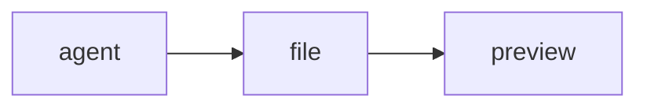

# Preview demo

Edit this file from the terminal tile; the preview reloads and keeps its scroll position.

| Tile | Kind | Live reload |
|---|---|:-:|
| 1 | Terminal | — |
| 2 | Markdown | yes |
| 3 | HTML | yes |

- [x] Raw HTML disabled
- [x] GitHub tables and task lists
- [ ] Mermaid (rendered as code for now)

```ts
// Highlighted in the preview origin, not the board.
export function greet(name: string): string {
  return `hello ${name}`;
}
```


See [the other page](other.md) (opens in this tile) or [Electron](https://www.electronjs.org/) (asks first).


